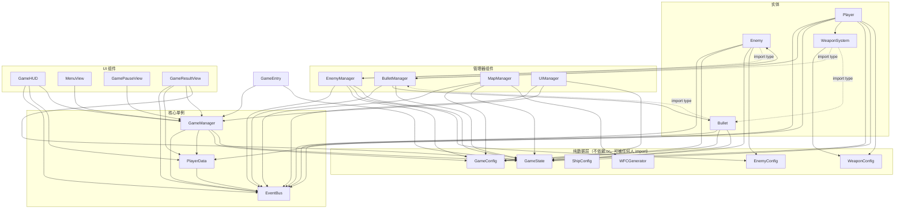
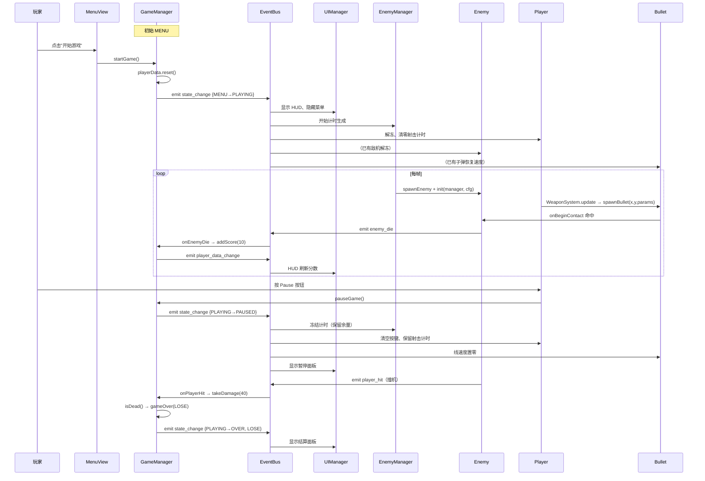

# PlaneWar 项目结构全图

> 本文档由代码实际内容整理得出，用于梳理文件职责、依赖关系与运行时顺序。
> 最后核对时间：2026-09-16

---

## 一、文件清单（20 个脚本）

```
assets/scripts/
├── GameEntry.ts              ← 唯一入口（挂场景空节点）
├── core/
│   ├── EventBus.ts           ★ 全局事件总线（单例）
│   └── WFCGenerator.ts       ← 纯算法，无 cc 依赖
├── data/
│   ├── GameState.ts          ← 枚举 + 负载类型（纯类型）
│   ├── PlayerData.ts         ★ 玩家数据单例
│   ├── DataManager.ts        （空文件）
│   ├── SettingsData.ts       （空文件）
│   └── config/
│       ├── GameConfig.ts     ← 全局常量（边界 / 速度 / 伤害）
│       ├── ShipConfig.ts     ← 机型表（纯数据）
│       ├── WeaponConfig.ts   ← 武器表（纯数据）
│       └── EnemyConfig.ts    ← 敌机表（纯数据）
├── entities/
│   ├── Player.ts             ← 玩家（Component）
│   ├── Enemy.ts              ← 敌机（Component）
│   ├── Bullet.ts             ← 子弹（Component）
│   └── WeaponSystem.ts       ← 武器逻辑（普通类，非 Component）
├── managers/
│   ├── GameManager.ts        ★ 状态机单例
│   ├── UIManager.ts          ← 面板显隐矩阵
│   ├── EnemyManager.ts       ← 敌机生成 + 回收
│   ├── BulletManager.ts      ← 子弹生成 + 回收
│   └── MapManager.ts         ← WFC 地图（内部用 WFCGenerator）
└── ui/
    ├── GameHUD.ts
    ├── MenuView.ts
    ├── GamePauseView.ts
    └── GameResultView.ts
```

---

## 二、依赖关系（import 图）



> **虚线 = `import type`**（编译后消失，专门用来打破循环依赖）。
> 这是本项目最值得记住的一招：
> `Enemy` ↔ `EnemyManager`、`Bullet` ↔ `BulletManager`、`WeaponSystem` ↔ `Bullet/BulletManager`
> 都是靠它解开的。

---

## 三、依赖分层（自下而上，谁都不许向下依赖）

| 层 | 文件 | 特征 |
|---|---|---|
| **L0 纯数据** | `GameState` / `GameConfig` / `ShipConfig` / `WeaponConfig` / `EnemyConfig` | **不 import `cc`**，可被任何层引用 |
| **L1 基础设施** | `EventBus` / `WFCGenerator` | 也是纯 TS，无 cc 依赖 |
| **L2 数据单例** | `PlayerData` | 只依赖 `EventBus` |
| **L3 逻辑单例** | `GameManager` | 依赖 L0 / L1 / L2 |
| **L4 实体** | `Player` / `Enemy` / `Bullet` / `WeaponSystem` | 依赖 L0~L2，**不依赖 Manager 运行时**（只 `import type`） |
| **L5 管理器组件** | `EnemyManager` / `BulletManager` / `MapManager` / `UIManager` | 可以运行时持有 L4 |
| **L6 UI** | `GameHUD` / `MenuView` / `GamePauseView` / `GameResultView` | 只依赖 `GameManager` / `PlayerData` / `EventBus` |
| **L7 入口** | `GameEntry` | 只做启动引导 |

**关键规律**

- L4 实体**不允许运行时 import L5 管理器**（会成环），只能通过 `init(manager)` **注入**。
- 反过来 L5 → L4 是正常依赖，随便用。

---

## 四、事件总线（真正的"隐形连接"）

这些组件之间**互相不认识**，全靠 `eventBus` 通信：

| 事件名 | 发布者 | 订阅者 |
|---|---|---|
| `state_change` | `GameManager`（唯一） | `Player`、`Enemy`、`Bullet`、`EnemyManager`、`BulletManager`、`MapManager`、`UIManager`、`GameResultView`（共 8 处） |
| `player_data_change` | `PlayerData`（4 个写方法） | `GameHUD` |
| `enemy_die` | `Enemy` | `GameManager` → `addScore` |
| `player_hit` | `Enemy` | `GameManager` → `takeDamage` |
| `bullet_hit` | `Bullet` | ⚠️ **无人订阅（死事件）** |

`state_change` 是全局心跳 —— 8 个组件靠它实现「时间停止」暂停语义。

**订阅约定**

- 多实例组件订阅时**必须传 context（`this`）**，否则无法区分实例，只有第一个能订阅上。
- 载荷类型 `StateChangePayload = { oldState, newState, result }`，按需解构。
- `EventBus` 的 `EventCallback` 是 `(...args: unknown[])`，**必须手写载荷类型标注**，否则解构报错。

---

## 五、运行时的启动与执行顺序

### 阶段 A：引擎加载（Cocos 自动，非手动控制）

```
1. 加载 Game.scene
2. 反序列化所有节点 / 组件
3. 为每个组件实例注入 @property（Inspector 里拖的引用）
4. 按节点树顺序调用各组件 onLoad()
5. 调用各组件 start()、onEnable()
6. 每帧调用 update(dt)
```

> `@property` 在 `onLoad` 之前**必然已赋值** —— 所以 `Player.onLoad` 里能放心用 `this.bulletManager`。

### 阶段 B：首个帧的 `onLoad` 顺序（受节点树顺序影响）

```
GameRoot/
├── Map      → MapManager.onLoad      ← 订阅 state_change
├── Enemies  → EnemyManager.onLoad    ← 订阅 state_change
├── Bullets  → BulletManager.onLoad   ← 订阅 state_change
├── Player   → Player.onLoad          ← 订阅 + weapon.bind(bulletManager)
└── ...
UI/
└── UIManager.onLoad                  ← 订阅 + 实例化 4 个面板
                                        + 主动调 onStateChange(快照)
GameEntry（Canvas 同级）→ GameEntry.start()   ← 最后启动引导
```

**⚠️ 隐蔽的顺序陷阱**：`UIManager.onLoad` 比 `GameEntry.start` **先执行**。
此时 `GameManager` 的 `currentState` 是构造函数给的默认值 `MENU`。
`UIManager` 末尾手动调了一次 `onStateChange(getStateSnapshot())`，所以面板显隐能正确初始化。
**如果删掉那一行，启动时所有面板都会是隐藏的。**

### 阶段 C：`GameEntry.start()` 启动引导

```ts
gameManager.initListeners()               // 订阅 enemy_die / player_hit
gameManager.setGameState(GameState.MENU)  // MENU → MENU 被去重，不广播
```

> 注意：这里 `setGameState(MENU)` 因为**同状态去重**而**不会 emit**。
> 所以 `MENU` 状态的广播从未真正发出过 —— 全靠 `UIManager.onLoad` 那次手动拉快照兜底。

### 阶段 D：一局游戏的完整流程



---

## 六、状态机与「时间停止」暂停语义

### 状态迁移表

| 迁移 | 计时 / 进度 | 生成 / 运动 |
|---|---|---|
| MENU → PLAYING | 清零 | ▶️ 开始 |
| **PLAYING → PAUSED** | **冻结、不清零** | ⏸️ 停止 |
| PLAYING → OVER | 清零 | ⏸️ 停止 |
| **PAUSED → PLAYING** | **从冻结处继续** | ▶️ 恢复 |
| PAUSED → MENU | 清零 | ⏸️ 停止 |
| OVER → PLAYING | 清零 | ▶️ 开始 |
| OVER → MENU | 清零 | ⏸️ 停止 |

- **PLAYING ↔ PAUSED 之间保留进度**，其余迁移一律清零。
- 例：`spawnInterval = 1`，暂停时已累积 0.9s → 恢复后 0.1s 即出下一架。
- 各组件只管自己"要不要继续推进"，不管别人。
- 实现的两种典型写法：
  - **计时类**（`EnemyManager`）：`onStateChange` 里对 PAUSED 相关迁移早退，直接 return 不动 timer。
  - **位移类**（`Enemy`）：`update` 首行 `if (isPaused) return` —— 位置累积在节点坐标里，冻结时自然原地保留，无需记录进度。

---

## 七、场景里必须存在的节点与组件（接线清单）

```
Game.scene
└── Canvas
    ├── Camera
    ├── GameRoot
    │   ├── Map          + MapManager         （waterFrame / grassFrames / sandFrames）
    │   ├── Enemies      + EnemyManager       （enemyPrefabs 数组 ← 顺序须与 ENEMY_CONFIGS 一致）
    │   ├── Bullets      + BulletManager      （bulletPrefab + bulletContainer）
    │   └── Player       + Player             （bulletManager → Bullets / weaponId / shipSprites）
    └── UI
        └── UIManager    + UIManager          （4 个 Layer + 4 个 Prefab）
```

- `Player.prefab` / `Enemy.prefab` / `Bullet_1.prefab` 里各自带 `RigidBody2D` + `Collider2D`。
- `UIManager` 会自动实例化 `Menu` / `HUD` / `GamePause` / `GameResult` 四个 UI prefab。
- **容器节点必须「位置 (0,0)、scale (1,1,1)」**，否则子节点局部坐标被缩放，出生点 / 边界判定全部错位。
- 容器的兜底规则：**`容器 ?? this.node`** —— 推荐直接把 Manager 组件挂在容器节点上，连引用都不用拖。

---

## 八、当前卡住的三个问题

### 1. `PhysicsSystem2D.instance.enable = true` 被注释掉了

`GameEntry.ts` 第 11 行 —— 物理系统没开，**所有刚体都不会动、不会碰撞**。

### 2. `bullet_hit` 是死事件

`Bullet` 命中时 emit 了 `bullet_hit`，但 `GameManager.initListeners()` 只订阅了
`enemy_die` 和 `player_hit`。无人订阅，可以删。

### 3. 伤害管道"两头没接"

```
WeaponConfig.levels[].damage          ✅ 有数据
  → WeaponSystem.makeShot()           ✅ 已注入 params.damage
  → BulletSpawnParams.damage          ✅ 已定义
  → Bullet.damage                     ✅ 已存字段
  → Bullet 命中时传给敌机              ❌ 断在这里
  → Enemy.takeDamage()                ⚠️ 方法写了，但没人调用
  → enemy_die 载荷带 score            ❌ 缺（GameManager 只能 addScore(10)）
  → player_hit 载荷带 collideDamage   ❌ 缺
```

**修复清单（3 个文件、5 处小改动）**

| 文件 | 改什么 |
|---|---|
| `Enemy.ts` | ① 子弹分支改为 `getComponent(Bullet)` + 调 `takeDamage(bullet.damage)`<br>② `takeDamage` 里补 `enemy_die` 广播（带 `score`）<br>③ `player_hit` 载荷带上 `this.collideDamage`<br>④ `despawn()` 加 `isValid` 保护（`scheduleOnce` 里再 destroy 可能已失效） |
| `GameManager.ts` | ⑤ `onEnemyDie` 改读载荷 `score`（删写死 `+10`）、`onPlayerHit` 改读载荷伤害 |
| `Bullet.ts` | ⑥ `damage` / `pierce` 字段已就绪，命中时不销毁自己 —— 留到第二步 |
